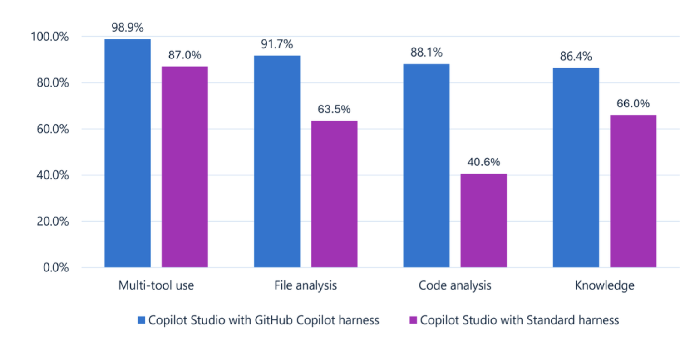

# 모듈 1. Copilot Studio와 Microsoft Copilot 하네스 에이전트 소개

## 학습 목표

- Copilot Studio에서 에이전트와 Workflow가 맡는 역할을 구분합니다.
- Standard 하네스와 Microsoft Copilot 하네스의 작성 방식 차이를 이해합니다.
- 이번 과정의 에이전트 구성과 개인별 데이터 흐름을 이해합니다.

```{warning}
Microsoft Copilot 하네스 관련 기능은 환경과 릴리스 시점에 따라 화면이나 제공 범위가 다를 수 있습니다. 이 과정은 Microsoft Copilot 하네스 화면을 기준으로 하며, 기존 기본 과정의 Classic UI 전환 안내를 적용하지 않습니다.
```

## 1. Copilot Studio와 하네스 이해하기

Copilot Studio는 지식에 답변하고 도구를 사용하여 업무를 수행하는 에이전트와, 정해진 순서로 작업을 자동화하는 Workflow를 만드는 서비스입니다. 더 나아가 자연어 명령으로 전통적인 어플리케이션 구축까지 가능합니다.

**하네스(Harness)** 는 요청을 해석하고 에이전트의 구성 요소를 사용하여 작업을 수행하는 기반입니다. 이 과정은 VS Code의 GitHub Copilot이라는 인공지능 비서를 사용하는 개발 과정이 아닙니다. 본 과정에서는 Copilot Studio 안의 **Microsoft Copilot 하네스** 구조를 사용하여 에이전트를 구축하는 과정을 살펴봅니다.

| 구분 | Standard 하네스 | Microsoft Copilot 하네스 |
|---|---|---|
| 작성 방식 | 토픽, 트리거, 명시적인 대화 흐름과 Instructions를 활용 | Instructions와 Skills를 중심으로 요청 해석과 다단계 작업을 구성 |
| 절차 표현 | 토픽의 질문·조건·작업 노드 등 | 요청별 Skill과 Tool 선택, 필요한 경우 결정적인 Workflow 호출 |
| 이번 과정에서의 사용 여부 | 개념 비교만 수행 | 모든 실습 에이전트와 Workflow에 사용 |

Standard 하네스도 생성형 기능을 지원하므로 단순히 "규칙 기반 대 AI 기반"으로 두 하네스를 구분하기는 어렵습니다.

성능 측면에서는 아래 Microsoft 공개 벤치마크에서 Microsoft Copilot 하네스가 Standard 하네스보다 다중 도구 사용(98.9% 대 87.0%), 파일 분석(91.7% 대 63.5%), 코드 분석(88.1% 대 40.6%), 지식 활용(86.4% 대 66.0%)에서 높은 결과를 보였습니다. 이는 해당 벤치마크의 비교 결과이며, 실제 업무에서의 성능은 모델과 에이전트 구성, 데이터 및 작업에 따라 달라질 수 있습니다.



출처: [More powerful agents and workflows for autonomous business processes: Introducing a new harness for Copilot Studio | Microsoft Community Hub](https://techcommunity.microsoft.com/blog/copilot-studio-blog/more-powerful-agents-and-workflows-for-autonomous-business-processes-introducing/4542969)

## 2. 출장 준비 도우미의 구성 살펴보기

| 구성 요소 | 이번 실습에서 담당할 일 |
|---|---|
| Instructions | 역할, 지원 범위, 근거 없는 승인 금지, 등록 전 확인 |
| Knowledge | 개인 OneDrive의 출장 규정·경비 기준·준비 가이드 |
| Skill: `trip-precheck` | 일정과 비용 확인, 계산, 정책 검토, 체크리스트 작성 |
| Skill: `trip-plan-report` | 패키지에 포함된 PPTX 템플릿의 3장을 채워 출장 계획서 생성 |
| Tool: 출장 계획 등록 | Excel 커넥터의 행 추가 작업으로 개인 출장 목록에 등록 |
| Outlook 관련 MCP | Work IQ (Preview)의 메일 조회 도구로 본인에게 온 방문 안내 확인 |
| Workflow Tool: 출장 PPT 전달 | 본인에게 PPT 첨부 이메일 발송 후 같은 파일을 개인 OneDrive에 저장 |

Knowledge는 **규정의 근거**, Excel은 **현재 기록**, Skill은 **수행 방법**, Workflow는 **정해진 처리 순서**입니다.

## 3. 네 개의 탭 살펴보기

1. 에이전트를 하나 만듭니다.
2. **Build**에서 Instructions, Knowledge, Skills, Tools 구성 위치를 확인합니다.
3. **Preview**에서 대화를 테스트하고 출처와 도구 실행 정보를 관찰합니다.
4. **Evaluate**에서 반복 실행할 테스트 세트를 관리하는 위치를 확인합니다.
5. **Monitor**에서 게시 후 운영 세션, 결과, 피드백, 사용량을 확인하는 위치를 봅니다. 아직 사용하지 않은 에이전트의 빈 화면은 정상입니다.

## 완료 체크리스트

- [ ] Copilot Studio를 이해합니다.
- [ ] 에이전트 유형인 Standard 하네스와 Microsoft Copilot 하네스의 차이점을 이해합니다.
- [ ] Build → Preview → Evaluate → 게시 → Monitor 흐름을 이해합니다.

## 참고 자료

- [Microsoft Copilot 하네스 에이전트 개요](https://learn.microsoft.com/microsoft-copilot-studio/agents-experience/overview)
- [Copilot Studio의 하네스](https://learn.microsoft.com/microsoft-copilot-studio/harnesses-overview)
- [Microsoft Copilot 하네스 Workflow 개요](https://learn.microsoft.com/microsoft-copilot-studio/workflows-experience/flows-overview)

[이전: 과정 안내](course-overview.md) · [다음: 실습용 솔루션 만들기](module02-create-solution.md)
